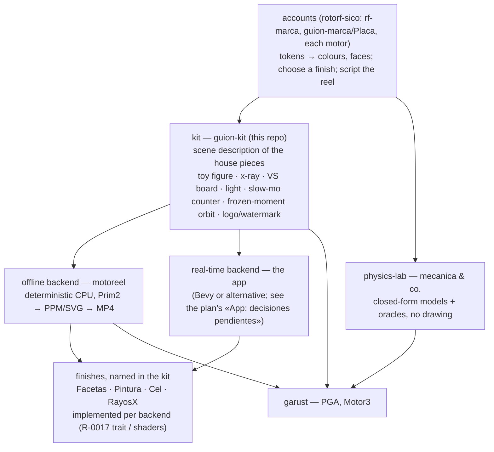

# ADR-0006 — Layered architecture: physics, kit, backends, finishes

- **Status:** Proposed. The owner approved the direction on 2026-11-22
  («dale con tu recomendación»). The requirements it spawns (motoreel R-0017,
  R-0018, and the kit's own) still need his OK before anything is built.
- **Date:** 2026-11-22
- **Deciders:** owner (final authority) + Claude (proposal)
- **Scope:** cross-repo: garust, physics-lab, guion-video-creator, motoreel,
  rotorf-sico (and a future fitness app)
- **Spawns:** motoreel
  [R-0017](https://github.com/westerngazoo/motoreel/blob/main/requirements/0017-interchangeable-finish.md)
  (interchangeable finish) and
  [R-0018](https://github.com/westerngazoo/motoreel/blob/main/requirements/0018-faceted-3d.md)
  (faceted 3D); a `guion-kit` requirement in this repo (to be written at
  phase 1); the migration plan in
  [`docs/migration-kit-and-finishes.md`](../migration-kit-and-finishes.md)

## Context

[ARCHITECTURE.md §2](../ARCHITECTURE.md) draws the ecosystem as garust →
physics-lab / motoreel → guion → creator projects. In practice the creator
project rotorf-sico (five Instagram accounts) has grown a sixth, implicit
layer: **house pieces drawn by hand, copied account to account.** A survey
of `origin/main` on 2026-11-22 found:

- **The logo and watermark machinery, three copies.**
  `computar/`, `sobreviviente/` and `maistro/motor/src/bin/marca.rs` each
  define their own `ffmpeg`, `cargar`, `png_rgba` and `rgba_transparente`.
  The bodies of the first three are byte-identical; `rgba_transparente` is
  identical between sobreviviente and maistro. `mockup` is a near-copy in all
  three. `canvas`, `png`, `png_con_fondo`, `svg` and `renglones` are identical
  between sobreviviente and maistro. Each account's `src/marca.rs` repeats
  `dentro` (identical in all three) and the constants `C` and `DENTRO`.
- **fbf's closing pieces, four copies.** `fbf/motor/src/bin/top_{biceps,
  brazo,hombro,triceps}_goose.rs` share identical `logo`, `sello`, `cuadro`,
  `casillas`, `cabecera`, `portada` and `version`.
- **The x-ray sweep timing, 13 copies.** `barrido_x` is defined in 13
  `fbf/motor/src/bin/*.rs` files with 5 distinct bodies (8 identical), next to
  the shared `vs_dibujo::barrido_x`. One more lives in
  `mathematicus/content/posts/root-two-irrational/escena.rs`.
- **The toy imitated.** `sobreviviente/motor/src/lib.rs` has its own
  `capsula` (12 segments, one radius) and `elipse` (48 sides), next to fbf's
  `juguete::capsula` (10 segments, two radii) and `elipse` (28 sides).
  `sobreviviente/motor/src/luz.rs` describes its `miembro` and `volumen` as
  "like the house toy". The unmerged `fbf/lote-2-vs-wip` branch adds
  `monito_libre.rs`, "the same pieces as `juguete`", for poses `juguete`
  cannot reach.
- **Provenance typed twice.** `fbf/motor/src/tablero_vs.rs::Procedencia`
  (`Calculado`, `Reportado(String)`, `Supuesto`) and this repo's
  `guion-gadget::valor::Procedencia` (`Calculado`, `Medido`, `Reportado`,
  `Supuesto`).
- **Physics inside a motor.** `fbf/motor/src/guia_profundidad.rs`,
  `curl_tecnica.rs`, `barra_rebote.rs` and the model half of
  `estilo_monito.rs` are closed-form models living in a video motor. That
  goes against the owner's 2026-10-06 decision that motors consume
  physics-lab and never copy it. Two of them (`curl_tecnica`, `barra_rebote`)
  also import the scoreboard's `tablero_vs::{Fila, Procedencia}`, so the
  physics depends on a drawing.
- **The finish threaded by hand.** `fbf/motor/src/juguete.rs` has `enum
  Acabado { Capas, Suave }`, and each piece grew a `_con` variant to carry
  it. A third look would double them again.

Two goals add pressure. The owner wants new looks (painterly, toon) and real
3D for the same pieces. He also plans a fitness app on fbf that would
reuse the physics and the pieces **in real time**. That app cannot run
motoreel's CPU rasteriser at 60 fps, and motoreel's founding rule is
"deterministic offline rendering, not a game engine" (motoreel
`project-specifics.md`).

## Decision

Adopt five layers. Dependencies point downward only:

1. **garust** stays the kernel: PGA and `Motor3`, the only motion
   representation.
2. **physics-lab** owns every model, with its oracles. Models return
   numbers and poses, never `Prim2`, colours or scoreboard rows. fbf's
   in-motor models move there (plan phase 4).
3. **The kit, `guion-kit`, a new crate in this repo,** describes the house
   pieces as data plus pure functions of time. It has no account in it: colours
   arrive resolved (`Rgb` per role) and faces arrive from the account's brand
   layer, so one piece serves every account. Most of its "description" types
   already exist in rotorf-sico (`Fila`, `Diseno`, `Pose`, `Tonos`,
   `Escenario`) and move rather than get invented. The kit receives numbers
   from physics-lab through the account's script. It never calls a model
   itself, so a scoreboard cannot disagree with the physics it shows.
4. **Backends** turn a description into pixels:
   - **motoreel**, offline and deterministic (same source, same bytes), for
     every video. The adapter lives in `guion-kit` behind a default
     `motoreel` feature, so the description builds without motoreel for the
     app. It produces R-0017 surfaces (and R-0018 meshes once they exist).
     It is still the only offline engine.
   - **A real-time backend** for the app, in the app's own repo. It
     implements the same description. Byte equality with motoreel is not a
     goal, only "the same piece, the same named finish".
5. **Finishes** are named in the kit (`Facetas`, `Pintura`, `Cel`,
   `RayosX`) and implemented per backend: in motoreel by the R-0017 trait,
   in the app as shaders. `Facetas` must reproduce today's low-poly output
   byte for byte.

**The invariant that governs the migration:** every phase keeps every
published reel byte-identical, as proven by rotorf-sico
`tools/golden-reels.sh`. Plan phase 0 first extends that script to cover
the reels each later phase touches.

## Consequences

**Positive.**
- One copy of each house piece. A fix or a new account inherits it.
- New looks become one value per reel instead of a `_con` variant per
  function.
- 3D comes from motoreel's existing motor and camera model (R-0002), not
  from a third hand-written camera after `tres.rs` and `atras.rs`.
- The app can reuse physics and pieces without the video determinism
  constraint, and videos keep that constraint without the app's.

**Negative, accepted.**
- One more crate, and one more cross-repo path dependency for rotorf-sico.
  Its motors already path-depend on motoreel, guion-video-creator and
  physics-lab, and the merge order of rotorf-sico `docs/infra.md` §2b
  applies: this repo first, then rotorf-sico.
- Until the app exists, the kit's description has a single backend.
  CLAUDE.md §2 and the owner's engineering standards warn against an
  abstraction with one implementation. The mitigation is that the
  description is the parameter structs the pieces already take, not a
  parallel type hierarchy. Phase 8 (the spike) is where the second backend
  proves the seam is real. If it does not, the seam gets cut back.
- Moving code across repos loses `git blame`, because a cross-repo move is a
  delete and an add. Each move PR cites the source commit.

## Alternatives considered

1. **A game engine for the videos too** (Bevy, Godot or Unity, capturing
   frames offline). *Rejected:* GPU rasterisation is not bit-reproducible
   across drivers, devices and engine versions (MSAA resolve, shader
   compilers, fused multiply-add). The house loses "same source, same bytes",
   which is what lets `golden-reels.sh` prove a refactor changed nothing and
   what makes "a change in the MP4 always comes from a change in the source"
   true (rotorf-sico CLAUDE.md §3b). It would also need a GPU in the cloud
   render, where motoreel runs on CPU today.
2. **Blender headless** (`bpy` scripts, EEVEE/Cycles, Freestyle or Grease
   Pencil for NPR looks). *Rejected:* a heavy, fast-moving dependency (a full
   Blender install per machine and per cloud session, and a Python API that
   changes between releases). EEVEE needs a GPU, and Cycles is reproducible
   only with fixed seeds on the same device. It breaks the owner's
   2026-09-30 rule that new animation is Rust on motoreel and garust. It would
   put physics across a Rust-to-Python bridge, against "motors consume
   physics-lab".
3. **A `wgpu` real-time backend inside motoreel.** *Rejected for now:*
   motoreel `project-specifics.md` lists it as out of scope "until
   re-decided", and mixing a real-time path into the deterministic crate
   dilutes its one promise. The app's backend lives in the app.
4. **Keep the per-account copies** (status quo). *Rejected:* the survey
   above shows the copies multiplying (the x-ray timing alone has 13 copies)
   and drifting (5 distinct `barrido_x` bodies, two `capsula` tessellations).
5. **The kit inside rotorf-sico** (`brand/kit`). *Rejected:* the owner's
   2026-10-14 rule puts what is generic in its own repo with its own process.
   The app would then depend on a content repo.
6. **The kit emits `Prim2` directly, with no description.** *Rejected as the
   end state, adopted as the first step:* phases 1–3 move pieces whose
   inputs are already plain parameter structs, so the description costs
   nothing extra. Only phase 8 needs it to be backend-free.

## References

- motoreel `project-specifics.md` (determinism, out-of-scope `wgpu`), R-0002,
  R-0016, R-0017, R-0018.
- rotorf-sico `docs/infra.md` §2 and §2b (what each repo owns, merge order),
  `docs/decisions.md` (2026-09-30 Rust-only animation, 2026-10-06 physics in
  physics-lab, 2026-10-14 generic pieces to their repo, 2026-11-18
  «juguete + rayos X»), `tools/golden-reels.sh`.
- R. L. Cook, "Shade Trees", SIGGRAPH '84; Khronos glTF 2.0 (2017); Pixar
  Universal Scene Description: scene description kept separate from the
  renderer.
