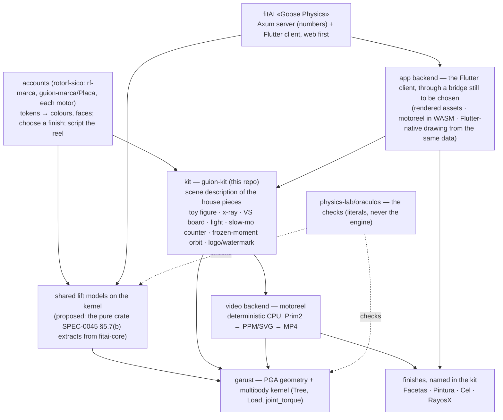

# ADR-0006 — Layered architecture: kernel, checks, kit, backends, finishes

- **Status:** Proposed. The owner approved the direction on 2026-11-22
  («dale con tu recomendación»). The requirements it spawns (motoreel R-0017,
  R-0018, the kit's own and the shared lift-model crate's) still need his OK
  before anything is built.
- **Date:** 2026-11-22. Revised the same day: the fitness app already exists
  (fitAI, «Goose Physics»), which changes the physics layer and the app
  backend.
- **Deciders:** owner (final authority) + Claude (proposal)
- **Scope:** cross-repo: garust, physics-lab, guion-video-creator, motoreel,
  rotorf-sico, and fitAI (read only from this ADR: fitAI decides its own
  changes under its own process)
- **Spawns:** motoreel
  [R-0017](https://github.com/westerngazoo/motoreel/blob/main/requirements/0017-interchangeable-finish.md)
  (interchangeable finish) and
  [R-0018](https://github.com/westerngazoo/motoreel/blob/main/requirements/0018-faceted-3d.md)
  (faceted 3D); a `guion-kit` requirement in this repo (phase 1); the
  shared lift-model crate (a fitAI requirement, phase 4); the migration plan
  in [`docs/migration-kit-and-finishes.md`](../migration-kit-and-finishes.md)

## Context

### The reels

[ARCHITECTURE.md §2](../ARCHITECTURE.md) draws the ecosystem as garust →
physics-lab / motoreel → guion → creator projects. In practice the creator
project rotorf-sico (five Instagram accounts) has grown an implicit layer:
**house pieces drawn by hand, copied account to account.** A survey of
`origin/main` on 2026-11-22 found:

- **The logo and watermark machinery, three copies.**
  `computar/`, `sobreviviente/` and `maistro/motor/src/bin/marca.rs`.
  - `ffmpeg`, `cargar` and `png_rgba` are byte-identical in all three.
  - `rgba_transparente`, `canvas`, `png`, `png_con_fondo`, `svg` and
    `renglones` are identical between sobreviviente and maistro.
  - `mockup` is a near-copy in all three.
  - `dentro` and the constants `C` and `DENTRO` are repeated in each
    account's `src/marca.rs`.
- **fbf's closing pieces, four copies.** `fbf/motor/src/bin/top_{biceps,
  brazo,hombro,triceps}_goose.rs` share identical `logo`, `sello`, `cuadro`,
  `casillas`, `cabecera`, `portada` and `version`.
- **The x-ray sweep timing, 13 copies.** `barrido_x` is defined in 13
  `fbf/motor/src/bin/*.rs` files with 5 distinct bodies (8 of them identical),
  next to the shared `vs_dibujo::barrido_x`. One more lives in
  `mathematicus/content/posts/root-two-irrational/escena.rs`.
- **The toy imitated.** `sobreviviente/motor/src/lib.rs` has its own
  `capsula` (12 segments, one radius) and `elipse` (48 sides), next to fbf's
  `juguete::capsula` (10 segments, two radii) and `elipse` (28 sides).
  The unmerged `fbf/lote-2-vs-wip` branch adds `monito_libre.rs`, "the same
  pieces as `juguete`".
- **Provenance typed twice.** `fbf/motor/src/tablero_vs.rs::Procedencia`
  and `guion-gadget::valor::Procedencia`, with different variants.
- **The finish threaded by hand.** `fbf/motor/src/juguete.rs` has `enum
  Acabado { Capas, Suave }`, and each piece grew a `_con` variant to carry
  it.

### The app already exists, and the squat already disagrees

The fitness app is **fitAI («Goose Physics»)**, `~/projects/fitAI`, on its
own wizzielyn process:
- a **Flutter** client (`mobile/`, iOS, Android and web), **web first** by
  the owner's decision, with the web build live on Cloudflare Workers;
- a **Rust Axum** backend (`backend/`) on Neon Postgres. Every number on
  the app's screen comes from the server (fitAI R-0067).

Its physics was decided in fitAI **ADR 0001** (accepted 2026-10-23):

- **garust is the mechanics kernel.** A lift is a 3D kinematic `Tree` over PGA
  motors (`garust-geo`) with `Load`s, and quasi-static inverse dynamics come
  from `garust-physics::multibody::joint_torque`. Every moment is
  cross-checked by virtual work (`generalized_torque`). The garust glue lives
  in one module, `backend/crates/core/src/biomech/kernel.rs` (`PlanarTree`),
  and the squat builds its tree there (`biomech/squat.rs`).
- **`physics-lab/oraculos` pins garust's conventions** with hand-computed or
  cited literals.
- **`physics-lab/mecanica` is prior art, not a dependency**, because its
  anthropometry disagreed with fitAI's.

fitAI R-0066 (accepted 2026-11-21) extends the same kernel to an exercise
library (free weight, cable, guided rail, lever or cam). It treats the fbf
reels as prior art, never as a source of numbers.

The disagreement is concrete. fitAI SPEC-0045 §2.4.3 records that the reel
"MECÁNICA 01" publishes **274 N·m** at the hip for a 100 kg bar. That is the
bar-only component. The full model, which also counts the body's segments
and solves the trunk for balance, gives **370.6 N·m**, 35% more. On
2026-10-17 the owner decided **one engine for the app and the reels**
(SPEC-0045 §5.7(b)). fbf's own manual says "cada número del reel es uno que
la app tendrá que sostener". Today fbf's squat models
(`fbf/motor/src/estilo_monito.rs`, `guia_profundidad.rs`, `sentadilla.rs`)
still compute **bar only**, with the bar plumb over the midfoot, on
`mecanica`'s lengths. fitAI computes **body plus bar**, with the trunk solved
so the combined centre of mass sits over the midfoot. The same posture gives
different numbers.

## Decision

Adopt five layers. Dependencies point downward only:

1. **garust: geometry and the multibody kernel, shared by fitAI and the
   reels.** PGA, `Motor3`, the kinematic `Tree`, `Load`s and quasi-static
   inverse dynamics. Every moment a reel shows comes from the same kernel
   that fitAI serves, through the same lift models (below), not a model
   written inside a motor.
   - **The lift models on top of the kernel** (anthropometry and its
     scaling, the posture solvers, the exercise trees, the cross-check) are
     **one crate both consume**. The proposal is the pure crate fitAI's
     SPEC-0045 §5.7(b) already decided to extract from `fitai-core` (no I/O,
     builds for `wasm32`). fitAI re-exports it, and rotorf-sico's motors depend
     on it pinned by git rev. Its design (license, `LoadKg`, the wasm target,
     the reels' golden values) is open in that spec. The migration plan
     (phase 4) lists it, and fitAI decides it under its own process.
2. **physics-lab/oraculos: the checks.** Hand-computed or cited literals for
   garust's conventions and for each lift model. They are never the engine
   and never on the expected side of a comparison. physics-lab keeps its
   closed-form teaching models (`difraccion`, `vehiculo`, `mecanica`) for
   the web lab and for the published reels that already use them. New gym
   numbers do not come from `mecanica` (fitAI ADR 0001 §5).
3. **The kit, `guion-kit`, a new crate in this repo,** describes the house
   pieces as data plus pure functions of time. It has no account in it:
   colours arrive resolved (`Rgb` per role) and faces arrive from the account's
   brand layer. Its description types mostly already exist in rotorf-sico
   (`Fila`, `Diseno`, `Pose`, `Tonos`, `Escenario`) and move rather than get
   invented. The kit receives numbers. It never computes physics, so a VS
   board cannot disagree with the model it shows.
4. **Backends** turn a description into pixels:
   - **motoreel** for every video, offline and deterministic (same source,
     same bytes). It stays the only offline engine. The adapter lives in
     `guion-kit` behind a default `motoreel` feature.
   - **The Flutter app** (fitAI's client, web first), reached through a bridge
     still to be chosen. The options are listed in the plan's «App: decisiones
     pendientes»: rendered assets from motoreel, motoreel compiled to WASM,
     or Flutter-native drawing driven by the same description. This ADR does
     not pick one. The phase-8 spike informs that choice.
5. **Finishes** are named in the kit (`Facetas`, `Pintura`, `Cel`,
   `RayosX`). motoreel implements them through the R-0017 trait. A bridge
   that draws natively in Flutter re-implements them by name, and a bridge
   that runs motoreel gets them as they are. `Facetas` must reproduce today's
   low-poly output byte for byte.

**The invariant that governs the migration:** every phase keeps every
published reel byte-identical, as proven by rotorf-sico
`tools/golden-reels.sh` (extended first, plan phase 0). Phase 4 is the one
deliberate exception, because the one-engine decision makes it **change
numbers**. The plan isolates it: the published reels are frozen or
republished, the owner decides which, and no phase silently re-renders them.

## Consequences

**Positive.**
- One copy of each house piece. A fix or a new account inherits it.
- A reel's number and the app's number come from one implementation. The
  35% squat gap cannot reopen, because there is no second model left to
  drift from.
- New looks become one value per reel instead of a `_con` variant per
  function.
- 3D comes from motoreel's existing motor and camera model (R-0002). fitAI's
  3D `Tree` and R-0063's 3D bench share the same garust geometry.

**Negative, accepted.**
- **More cross-repo dependencies.** rotorf-sico's motors gain a git-pinned
  dependency on a crate that lives in fitAI. Both repos are public, but
  fitAI's backend is `UNLICENSED` while the motors' other dependencies are
  `MIT OR Apache-2.0`. That is an owner decision in SPEC-0045 §5.7(b)(c), and
  it blocks phase 4.
- **The reels' published squat numbers are low by the body's share.** When
  fbf moves to the shared model, its squat figures rise (the 274 → 370.6 N·m
  case). This is the point of the decision, but the published reels and
  `guion-video-creator/fixtures/dorados.json` (135 samples gated at 2%)
  must either pin the bar-only component or move with the correction.
  SPEC-0045 §5.7(b)(e) already lists this as an owner decision.
- Until the bridge exists, the kit's description has a single backend. The
  mitigation is that the description is the parameter structs the pieces
  already take. The phase-8 spike shows whether the seam is real, and if it
  is not, the seam gets cut back.
- Moving code across repos loses `git blame`, because a move becomes a delete
  plus an add. Each move PR cites the source commit.

## Alternatives considered

1. **A game engine for the videos** (Bevy, Godot or Unity, capturing frames
   offline). *Rejected.* GPU rasterisation is not bit-reproducible across
   drivers, devices and engine versions, so the house would lose "same source,
   same bytes". That property is what lets `golden-reels.sh` prove a refactor
   changed nothing (rotorf-sico CLAUDE.md §3b). A game engine would also need
   a GPU in the cloud render.
2. **Blender headless** (`bpy`, EEVEE/Cycles, Freestyle or Grease Pencil).
   *Rejected.*
   - It is a heavy, fast-moving dependency, with a Python API that changes
     between releases.
   - EEVEE needs a GPU, and Cycles is reproducible only with fixed seeds on
     the same device.
   - It breaks the owner's 2026-09-30 rule that new animation is Rust on
     motoreel and garust.
   - It would put physics across a Rust-to-Python bridge.
3. **A new real-time engine for the app (Bevy).** *Withdrawn.* The first
   draft of this ADR proposed one, before fitAI was known. The app already
   has its client stack (Flutter, web first) and its server stack (Axum).
   The open question is only how the kit's visuals reach that client.
4. **Gym physics consolidated in `physics-lab/mecanica`.** *Rejected.* This
   was the first draft's phase 4. fitAI ADR 0001 rejected `mecanica` as a
   dependency (its anthropometry disagreed by 35%), and the owner decided on
   one engine shared with the app.
5. **The kernel glue in garust and each lift model written twice** (fitAI
   and fbf each building their own trees on garust). *Rejected.* The 35% gap
   came from the anthropometry and the balance convention, not from the
   moment rule. Sharing only the kernel would leave both in two places.
6. **Keep the per-account copies** (status quo). *Rejected.* The copies are
   multiplying (13 for the x-ray timing alone) and drifting (5 distinct
   `barrido_x` bodies, two `capsula` tessellations).
7. **The kit inside rotorf-sico** (`brand/kit`). *Rejected.* The owner's
   2026-10-14 rule sends generic code to its own repo, and fitAI's client
   could not reuse a kit that lives in a content repo.

## References

- fitAI: `docs/decisions/0001-garust-as-mechanics-kernel.md`; SPEC-0045 §2.4.3
  and §5.7; R-0059, R-0062, R-0063, R-0065, R-0066, R-0067;
  `backend/crates/core/src/biomech/{kernel,squat}.rs`.
- motoreel `project-specifics.md` (determinism), R-0002, R-0016, R-0017,
  R-0018.
- rotorf-sico `docs/infra.md` §2 and §2b; `docs/decisions.md` (2026-09-30,
  2026-10-06, 2026-10-14, 2026-11-18); `fbf/CLAUDE.md`;
  `tools/golden-reels.sh`.
- physics-lab `oraculos/src/lib.rs` (the oracle rule).
- R. L. Cook, "Shade Trees", SIGGRAPH '84; Khronos glTF 2.0 (2017); Pixar
  Universal Scene Description: scene description kept separate from the
  renderer.
